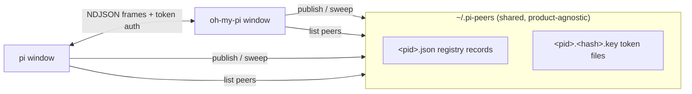

# pi-peers

**Let your coding agent windows talk to each other.** pi-peers is an extension that gives every running [pi](https://github.com/earendil-works/pi) or [oh-my-pi](https://github.com/can1357/oh-my-pi) session on your machine a presence, an inbox, and a voice — so an agent in one window can discover other windows, hand them tasks, and get results back. pi and oh-my-pi windows share one registry and can message **across products**, from a single plugin code path.

```
you@window-A:  "Ask my other window to summarize the diff it's reviewing
                and send me the result."

  window-A agent ──▶ send_peer_message(to: "api-work-40231", …)
                        │
                        ▼  (named pipe / unix socket, token-authenticated)
  window-B agent ◀── receives it as user input, works on it
                        │
                        ▼  replies with send_peer_message
  window-A agent ──▶ "Here's the summary from api-work-40231: …"
```

## Why

If you run several agent windows at once — one refactoring, one reviewing, one tailing logs — they are strangers to each other. pi-peers turns them into a team:

- **Delegate across windows**: "Tell the window working on the API to run the tests when it's done."
- **Coordinate long-running work**: subscribe with `notifyWhenIdle` and get pinged the moment a busy peer frees up, instead of polling.
- **Fan out**: one orchestrator window assigns tasks to three worker windows and collects their reports.
- **Cross-product**: pi and oh-my-pi instances see each other in the same `/peers` list and exchange messages transparently.

No server, no config files, no accounts — discovery is a directory (`~/.pi-peers`), transport is a per-process local IPC endpoint, and authentication is a token file readable only by you.

## Install

Requires a recent pi or oh-my-pi (both load TypeScript extensions natively; no build step) and Node.js ≥ 20. See [Host compatibility](#host-compatibility) for the tested baseline.

### pi

Install from npm — pi's package manager resolves the `npm:` source, installs the package, and loads the extension entry its `pi.extensions` manifest names (nothing to add to settings by hand):

```sh
pi install npm:@zengcool/pi-peers
```

`pi update --extensions` updates it later; `pi remove npm:@zengcool/pi-peers` removes it.

<details>
<summary>Alternative: git clone (pinned to a checkout)</summary>

```sh
git clone https://github.com/shuairongzeng/pi-peers ~/.pi/agent/extensions/pi-peers
cd ~/.pi/agent/extensions/pi-peers && npm install
```

</details>

### oh-my-pi

Install from npm — `omp plugin install` classifies scoped `@…` specs as npm targets, records the package in `~/.omp/plugins`, and the runtime loader reads the `omp.extensions` manifest entry:

```sh
omp plugin install @zengcool/pi-peers
```

<details>
<summary>Alternative: git clone (pinned to a checkout)</summary>

```sh
git clone https://github.com/shuairongzeng/pi-peers ~/.omp/agent/extensions/pi-peers
cd ~/.omp/agent/extensions/pi-peers && npm install
```

</details>

Restart any running windows. Every new window now joins the peer network automatically.

## Host compatibility

| Host | Baseline |
| --- | --- |
| [oh-my-pi](https://github.com/can1357/oh-my-pi) | 18.12 (development & test baseline) |
| [pi](https://github.com/earendil-works/pi) | fork, `shuairongzeng/pi` @ coding-agent 1.3.0 (development & test baseline) |
| Protocol | `peerProtocol` v1 (`msgV: 1`) — senders refuse peers whose `peerProtocol` exceeds their own |
| Node.js | ≥ 20 (matches the `engines` field in `package.json`) |

Both hosts are loaded from one code path (`src/index.ts` normalizes the pi/oh-my-pi API differences), so pi and oh-my-pi windows share one registry and interoperate transparently.

## Usage

Talk to your agent in natural language — it has a `send_peer_message` tool and knows the conventions:

> "List the other windows and ask each one what it's working on."

> "Send this stack trace to the window in ~/projects/api and have it diagnose the cause; notify me when it replies."

Or drive it yourself:

- `/peers` — list live peer sessions (name, status, context fill `ctx N%` when the host reports it, kind, working directory, disambiguation ref).

Tool reference (what the model sees):

| Call | Effect |
| --- | --- |
| `send_peer_message { action: "list" }` | Discover live peers on this machine. |
| `send_peer_message { action: "send", to, message }` | Deliver `message` to the peer's agent. `to` accepts a name (`"alice"`), a disambiguated name (`"alice [ab12cd]"`), a wire address copied from an incoming message, **or an array of any of those** to fan out the same message to up to 32 peers in one call (per-target results are aggregated; one failure doesn't abort the rest). |
| `… { priority: "now" }` | Interrupt the peer's current work immediately instead of queueing behind it. |
| `… { notifyWhenIdle: true }` | One-shot ping back to you when the peer goes idle — fires immediately if the peer is already idle. (Single-target sends only.) |
| `… { action: "shutdown", to, reason? }` | Ask a peer to close its session gracefully (same project scoping as send). The peer obeys its own accept policy: `all` closes immediately, `ask` prompts the human there, `off` refuses. Collect the peer's results **before** shutting it down. |
| `… { scope: "all" }` | Reach sessions in **other projects** (see below). |
| `spawn_peer({ name?, task?, headless?, ephemeral? })` | Launch a NEW agent instance as a managed peer. It reproduces your own host invocation (same binary/build), registers automatically, and is addressable by `name` right away. `task` is delivered the moment it comes online. `headless: true` runs it in the background (no terminal window); `ephemeral: true` makes it exit automatically once it has done its work and reported back. Windowed (non-headless) spawns are Windows-only for now — on macOS/Linux pass `headless: true`. |

### Project scope

Peers are scoped by project: a session's project is its git repository root (or its working directory outside a work tree). By default, `list` and `send` only see sessions in **your** project — windows in other repositories are invisible and unreachable, so an agent can never accidentally task a window from an unrelated project. `/peers` shows your project's sessions and summarizes the rest as `(+N sessions in other projects …)`. To deliberately reach across projects, pass `scope: "all"` to the tool.

Inbound messages arrive as user-role text wrapped in `<cross-session-message from="ADDRESS" from-name="NAME">…</cross-session-message>`, and the agent is instructed (via a system-prompt section the plugin injects) to reply by copying `from` into `to`. A send returns once the message reaches the peer's queue; an asynchronous receipt (`delivered` / `held` / `denied` / `refused` / `dropped`) follows into your session. If the peer's connection dies while your message is still being written, the send instead fails fast with a typed `connection_lost` error — a vanished peer never looks like a successful delivery.

## How it works



- **Discovery**: each instance publishes a `<pid>.json` record (name, status, kind, cwd, socket address, protocol version, liveness tokens) and sweeps records of dead processes on every scan.
- **Transport**: one IPC listener per instance — `\\.\pipe\LOCAL\pi-peer-<rand>` on Windows, a unix socket on POSIX. Newline-delimited JSON frames, ≤ 1 MiB, short-lived connections.
- **Authentication**: a per-process 0600 key file holds the peer token; senders read the target's key from the registry dir and must present the token on the first line. A separate child token (environment handoff) marks spawned subagents as trusted.
- **Receiver pipeline**: token-bucket rate limit → dedupe window → hop-chain loop guard → queue cap → optional user confirmation (`ask` policy) → injection into the agent loop as a user message. Receipts travel back over a fresh connection.
- **Agent convention**: a system-prompt section teaches the model that peer messages are not user intent, and to reply via the tool — this is what makes multi-hop conversations work without protocol changes.

## Configuration

| Variable | Meaning |
| --- | --- |
| `PI_PEERS_ACCEPT` | Inbound accept policy: `all` (accept silently — **the default**), `ask` (prompt the user), `off` (refuse). Peer messages are authenticated by a 0600 same-user token, so open-by-default is safe on a single-user machine; set `ask` on shared machines or while evaluating untrusted peers. |
| `PI_PEERS_DISABLED` | `1`/`true`/`yes` disables the extension entirely — no tool, no command, no listener. |
| `PI_PEERS_DIR` | Override the shared registry directory (default `~/.pi-peers`). All hosts read the same dir, so pi and oh-my-pi instances see each other. |
| `PI_PEERS_NAME` | Assigned by `spawn_peer` to name the spawned session (wins over derived naming; recorded as `nameSource: "env"`). |
| `PI_PEERS_EPHEMERAL` | Set by `spawn_peer` for ephemeral workers: the session exits on its first idle after doing work. |
| `PI_PEERS_SOCKET` / `PI_PEERS_TOKEN` | Parent→child handoff for spawned subagents. Read-only for users. |

## Security model

- **Authentication**: every process publishes a 0600 key file (`<pid>.<sha256(socketPath)>.key`) containing its peer and child tokens; inbound connections must present the matching token on the first line or they are dropped.
- **Anti-abuse**: inbound user frames pass a token-bucket rate limit, a dedupe window, a hop-chain guard (loop and runaway detection), and a queue cap; the outbox paces sends locally so a peer that would drop us fails fast with a merge-and-retry hint instead.
- **No central server**: the filesystem is the only shared truth; the registry is self-healing (records of dead pids and their key files are swept on every scan).

**Child-token exposure.** `PI_PEERS_SOCKET`/`PI_PEERS_TOKEN` are exported into the environment of every descendant process — any shell command the agent runs inherits them. That token authenticates child-class frames, which skip the accept policy (`PI_PEERS_ACCEPT=off` does NOT gate child frames) and can carry shutdown requests. This matches the documented trust model: on a single-user machine the user can already read the key files and do all of this — but do not treat `PI_PEERS_ACCEPT=off` as a sandbox against local processes.

**Accepted limitation — no post-auth connection caps.** Once a connection authenticates, there is no idle timeout or cap on concurrent inbound connections (frames themselves are rate-limited, line-buffered, and queue-capped). A token holder could pin connections to waste file descriptors — but a token holder is a same-user process, which can already `kill` this session outright. Adding caps would cost complexity without enlarging the trust boundary.

## Known host differences

- **oh-my-pi has no `session_info_changed`**: renames are not broadcast to other peers. A renamed oh-my-pi session republishes its (derived) name on the next `session_start`; until then, peers see the old name.
- **Idle delivery**: oh-my-pi's `sendUserMessage` with `deliverAs` only queues — it never starts a turn on an idle session; pi always routes through `prompt()`. The plugin therefore omits `deliverAs` when the receiving session is idle (both hosts then start a turn immediately) and passes `steer`/`followUp` only when the session is busy.
- **Shutdown budget**: hosts give `session_shutdown` handlers a short grace period (on the order of seconds) before continuing; registry unpublish and key deletion are best-effort synchronous, so this is normally ample, but a hung close could be cut off.

## Development

```sh
npm install        # once
npm test           # vitest run
npm run typecheck  # tsc --noEmit
```

### Releasing

Releases are fully automated via [npm Trusted Publishing](https://docs.npmjs.com/trusted-publishers)
(OIDC from GitHub Actions — no npm token anywhere): bump `version` in `package.json`,
update `CHANGELOG.md`, push, then tag `vX.Y.Z` and push the tag. The
[release workflow](.github/workflows/release.yml) verifies the tag matches the manifest,
runs the full typecheck + test gate, and publishes with a provenance attestation.
The workflow refuses to publish on anything but a tag push.

Source layout: `src/` holds the plugin; `src/types.ts` is the single dependency contract every module imports from; `src/index.ts` is the dual-host entry (pi + oh-my-pi API differences are normalized there). Tests in `test/` include a true end-to-end suite (two real protocol stacks exchanging frames over a live socket) and a dual-host wiring suite.

The protocol and interaction model are derived from a clean-room analysis of Claude Code's cross-session messaging, adapted to the pi extension API. Design rationale and the full reverse-engineering writeup live in the companion docs.

## Protocol appendix (for third-party implementers)

Everything below is the wire-visible contract; interoperable implementations must match it.

**Discovery.** `$PI_PEERS_DIR` (default `~/.pi-peers/`), mode `0700`. Each instance publishes `<pid>.json` (record: `version, pid, sessionId, cwd, projectRoot?, name, nameSource, formerNames, kind, status, statusUpdatedAt, startedAt, procStart, pidDomain, socketPath, peerProtocol, features[], contextUsage?`) and `<pid>.<sha256(socketPath)>.key` (mode `0600`, `{peerToken, procStart, pidDomain}` — the child token is never persisted). Atomic tmp+rename writes; a `list()` scan sweeps records whose pid is dead (liveness = `kill(pid,0)` + process-start-token compare) **or whose auth-key file is missing** (a live process without its key can never authenticate inbound connections — a broken zombie), along with their key files. Scan results are cached for 500 ms (mutations invalidate; `{fresh:true}` bypasses); `readRecord(pid)` is the O(1) single-record read for hot polling loops.

**Freshness semantics.** `statusUpdatedAt` stamps the last busy/idle *flip*, not the last heartbeat — a session busy for hours keeps its flip time. `contextUsage` refreshes on every status flip and on each turn boundary when the whole-percent value moved (in-memory snapshots stay exact; disk writes are gated to ≥1 percentage-point changes to avoid per-turn file churn). Liveness never relies on timestamps: it is always `kill(pid,0)` + start-token compare at read time.

**Versioning.** Records carry `peerProtocol` (currently 1) and `features[]`; frames carry `msgV: 1`. A sender MUST refuse a peer whose `peerProtocol` exceeds its own (error `protocol_version` — fail fast instead of having frames silently dropped), and SHOULD skip optional control frames the target's `features[]` does not advertise (`notify_idle` gates `notify_when_idle`). Receivers ignore unknown control actions and unknown frame fields (forward-compatible).

**Channel.** One short-lived connection per message. Windows: named pipe `\\.\pipe\LOCAL\pi-peer-<32 hex>`; POSIX: unix socket under `<registry>/socks/` (note: not uid-scoped — do not share `PI_PEERS_DIR` across users). Newline-delimited JSON, 1 MiB line cap, 30 s first-line budget.

**Handshake.** First line `{"type":"auth","token":"<peerToken from the target's key file>"}`. Token auth is enforced on every platform; POSIX additionally relies on the registry dir's `0700` mode. A parent hands its socket address + child token to spawned subagents via `PI_PEERS_SOCKET`/`PI_PEERS_TOKEN`; a child token marks the sender as first-class (no consent prompt, not hop-counted).

**Frames.** Envelope `{msgV:1, msg_id:uuid}` + `type: "user" | "control"`. User frame: `from/fromPid/fromSession`, optional `fromName`, `hopChain` (reserved for relay topologies: self-hop ≥10 drops, chain >28 drops — in the current direct-connect design every chain has length 1, so the effective loop protection is dedupe + per-sender and global rate buckets), `priority: "now"|"next"`, `content` — for model-authored sends, content is wrapped as `<cross-session-message from="ADDR" from-name="NAME">…</cross-session-message>`, and receivers re-wrap locally with the wire identity before injection (forged wrappers are dropped as `malformed-wrapper`). Addressing convention: `from` is always the sender's wire address; `reply_to` appears on control frames whose response must reach a specific endpoint (idle subscriptions). Control actions: `peer_message_status` (receipts: `held → delivered|denied|expired`, `refused`, `dropped:<reason>` — honored only for msg_ids the receiver actually sent), `notify_when_idle` (one-shot, nonce-correlated; fires immediately when the target is already idle; gated on the target's `features` advertising `notify_idle`), `peer_idle_notice` (honored only with a live one-shot nonce), `shutdown` (answered by `shutdown_response` with `inReplyTo` + `outcome: accepted|denied`), `rename` (formerNames chaining).

**Anti-abuse on receive.** Per-sender token bucket (30 burst, 0.5/s refill), a global bucket across all senders (120 burst, 2/s refill — rotating the `from` field buys nothing), a generous child-class bucket (120/10s) for token-authenticated subagent connections, 30 s dedupe window, queue cap 50 accepted-since-idle. Receipts flow back over a fresh connection to `reply_to` (or `from` when absent).

## License

MIT
