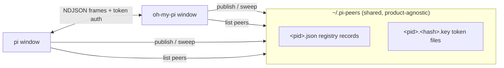

# pi-peers

**Let your coding agent windows talk to each other.** pi-peers is an extension that gives every running [pi](https://github.com/earendil-works/pi) or [oh-my-pi](https://github.com/can1357/oh-my-pi) session on your machine a presence, an inbox, and a voice — so an agent in one window can discover other windows, hand them tasks, and get results back. pi and oh-my-pi windows share one registry and can message **across products**, from a single plugin code path.

```
you@window-A:  "Ask my other window to summarize the diff it's reviewing
                and send me the result."

  window-A agent ──▶ send_peer_message(to: "api-work-40231", …)
                        │
                        ▼  (named pipe / unix socket, token-authenticated)
  window-B agent ◀── receives it as user input, works on it
                        │
                        ▼  replies with send_peer_message
  window-A agent ──▶ "Here's the summary from api-work-40231: …"
```

## Why

If you run several agent windows at once — one refactoring, one reviewing, one tailing logs — they are strangers to each other. pi-peers turns them into a team:

- **Delegate across windows**: "Tell the window working on the API to run the tests when it's done."
- **Coordinate long-running work**: subscribe with `notifyWhenIdle` and get pinged the moment a busy peer frees up, instead of polling.
- **Fan out**: one orchestrator window assigns tasks to three worker windows and collects their reports.
- **Cross-product**: pi and oh-my-pi instances see each other in the same `/peers` list and exchange messages transparently.

No server, no config files, no accounts — discovery is a directory (`~/.pi-peers`), transport is a per-process local IPC endpoint, and authentication is a token file readable only by you.

## Install

Requires a recent pi or oh-my-pi (both load TypeScript extensions natively; no build step). Developed and tested against oh-my-pi 18.12.

### pi

```sh
git clone https://github.com/shuairongzeng/pi-peers ~/.pi/agent/extensions/pi-peers
cd ~/.pi/agent/extensions/pi-peers && npm install
```

### oh-my-pi

```sh
git clone https://github.com/shuairongzeng/pi-peers ~/.omp/agent/extensions/pi-peers
cd ~/.omp/agent/extensions/pi-peers && npm install
```

Restart any running windows. Every new window now joins the peer network automatically.

## Usage

Talk to your agent in natural language — it has a `send_peer_message` tool and knows the conventions:

> "List the other windows and ask each one what it's working on."

> "Send this stack trace to the window in ~/projects/api and have it diagnose the cause; notify me when it replies."

Or drive it yourself:

- `/peers` — list live peer sessions (name, status, kind, working directory, disambiguation ref).

Tool reference (what the model sees):

| Call | Effect |
| --- | --- |
| `send_peer_message { action: "list" }` | Discover live peers on this machine. |
| `send_peer_message { action: "send", to, message }` | Deliver `message` to the peer's agent. `to` accepts a name (`"alice"`), a disambiguated name (`"alice [ab12cd]"`), or a wire address copied from an incoming message. |
| `… { priority: "now" }` | Interrupt the peer's current work immediately instead of queueing behind it. |
| `… { notifyWhenIdle: true }` | One-shot ping back to you when the peer next goes idle. |

Inbound messages arrive as user-role text wrapped in `<cross-session-message from="ADDRESS" from-name="NAME">…</cross-session-message>`, and the agent is instructed (via a system-prompt section the plugin injects) to reply by copying `from` into `to`. A send returns once the message reaches the peer's queue; an asynchronous receipt (`delivered` / `held` / `denied` / `refused` / `dropped`) follows into your session.

## How it works



- **Discovery**: each instance publishes a `<pid>.json` record (name, status, kind, cwd, socket address, protocol version, liveness tokens) and sweeps records of dead processes on every scan.
- **Transport**: one IPC listener per instance — `\\.\pipe\LOCAL\pi-peer-<rand>` on Windows, a unix socket on POSIX. Newline-delimited JSON frames, ≤ 1 MiB, short-lived connections.
- **Authentication**: a per-process 0600 key file holds the peer token; senders read the target's key from the registry dir and must present the token on the first line. A separate child token (environment handoff) marks spawned subagents as trusted.
- **Receiver pipeline**: token-bucket rate limit → dedupe window → hop-chain loop guard → queue cap → optional user confirmation (`ask` policy) → injection into the agent loop as a user message. Receipts travel back over a fresh connection.
- **Agent convention**: a system-prompt section teaches the model that peer messages are not user intent, and to reply via the tool — this is what makes multi-hop conversations work without protocol changes.

## Configuration

| Variable | Meaning |
| --- | --- |
| `PI_PEERS_ACCEPT` | Inbound accept policy: `all` (accept silently — **the default**), `ask` (prompt the user), `off` (refuse). Peer messages are authenticated by a 0600 same-user token, so open-by-default is safe on a single-user machine; set `ask` on shared machines or while evaluating untrusted peers. |
| `PI_PEERS_DISABLED` | `1`/`true`/`yes` disables the extension entirely — no tool, no command, no listener. |
| `PI_PEERS_DIR` | Override the shared registry directory (default `~/.pi-peers`). All hosts read the same dir, so pi and oh-my-pi instances see each other. |
| `PI_PEERS_SOCKET` / `PI_PEERS_TOKEN` | Parent→child handoff for spawned subagents. Read-only for users. |

## Security model

- **Authentication**: every process publishes a 0600 key file (`<pid>.<sha256(socketPath)>.key`) containing its peer and child tokens; inbound connections must present the matching token on the first line or they are dropped.
- **Anti-abuse**: inbound user frames pass a token-bucket rate limit, a dedupe window, a hop-chain guard (loop and runaway detection), and a queue cap; the outbox paces sends locally so a peer that would drop us fails fast with a merge-and-retry hint instead.
- **No central server**: the filesystem is the only shared truth; the registry is self-healing (records of dead pids and their key files are swept on every scan).

## Known host differences

- **oh-my-pi has no `session_info_changed`**: renames are not broadcast to other peers. A renamed oh-my-pi session republishes its (derived) name on the next `session_start`; until then, peers see the old name.
- **Idle delivery**: oh-my-pi's `sendUserMessage` with `deliverAs` only queues — it never starts a turn on an idle session; pi always routes through `prompt()`. The plugin therefore omits `deliverAs` when the receiving session is idle (both hosts then start a turn immediately) and passes `steer`/`followUp` only when the session is busy.
- **Shutdown budget**: hosts give `session_shutdown` handlers roughly 2 seconds before continuing; registry unpublish and key deletion are best-effort synchronous, so this is normally ample, but a hung close could be cut off.

## Development

```sh
npm install        # once
npm test           # vitest run
npm run typecheck  # tsc --noEmit
```

Source layout: `src/` holds the plugin; `src/types.ts` is the single dependency contract every module imports from; `src/index.ts` is the dual-host entry (pi + oh-my-pi API differences are normalized there). Tests in `test/` include a true end-to-end suite (two real protocol stacks exchanging frames over a live socket) and a dual-host wiring suite.

The protocol and interaction model are derived from a clean-room analysis of Claude Code's cross-session messaging, adapted to the pi extension API. Design rationale and the full reverse-engineering writeup live in the companion docs.

## License

MIT
